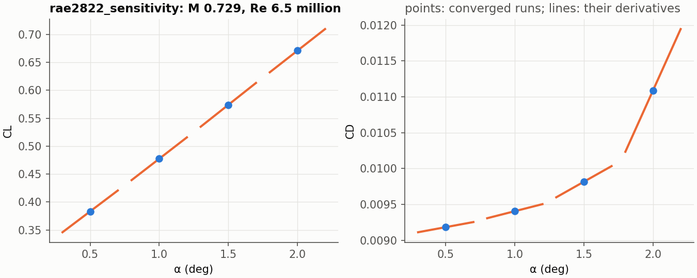

# JAX-RANS

**Differentiable compressible RANS in JAX.** Euler, laminar Navier-Stokes and
Spalart-Allmaras RANS on structured multi-block grids, 2D and 3D, in double
precision on GPUs (one or several), validated against NASA, AGARD and JAXA
reference data, with exact derivatives of the converged forces.

[](https://github.com/giovannicatalani/jax-rans/actions/workflows/tests.yml)
[](https://giovannicatalani.github.io/jax-rans/)
[](https://pypi.org/project/jax-rans/)
[](LICENSE)
[](https://colab.research.google.com/github/giovannicatalani/jax-rans/blob/main/notebooks/quickstart.ipynb)


*ONERA M6 wing, SA RANS, M 0.84, 3.06 deg, Re 14.6 million (NASA TMR): 1.08
million cells, 57 minutes on one NVIDIA A100.*

## Quickstart

```bash
pip install "jax-rans[plot] @ git+https://github.com/giovannicatalani/jax-rans"
jaxrans examples/naca0012_euler            # solve; results/naca0012_euler/
python -m jaxrans.plot results/naca0012_euler
```

For a GPU, install JAX with CUDA first
([instructions](https://docs.jax.dev/en/latest/installation.html)). A case is
two JSON files, the physics and the numerics; from Python:

```python
from jaxrans import load_case, run, sensitivity

result = run(load_case("examples/rae2822_sensitivity"))
print(result.forces.summary())
print(sensitivity(result, outputs=("cl", "cd"), parameters=("alpha", "mach")).summary())
```

Or try it in the browser, a transonic airfoil and its derivatives on a free
GPU: [quickstart notebook](notebooks/quickstart.ipynb)
[](https://colab.research.google.com/github/giovannicatalani/jax-rans/blob/main/notebooks/quickstart.ipynb).

## What it does

- **Physics**: compressible Euler, laminar Navier-Stokes, Spalart-Allmaras
  (SA-noft2, SA-neg, QCR2000); cell-centred finite volumes, HLLC or Roe
  fluxes, MUSCL reconstruction (minmod, van Albada, smooth van Albada or none).
- **Grids**: generated O- and C-grids round any airfoil from its coordinate
  file; generated slat-main-flap sections; any point-matched multi-block
  Plot3D or CGNS grid, 2D or 3D, with interfaces and patches found from the
  geometry.
- **Solvers**: pseudo-transient Newton-Krylov with line-implicit
  preconditioning, or explicit Runge-Kutta; grid sequencing; a polar's angles
  batched on the GPU; one large case split over several GPUs.
- **Derivatives**: dCL, dCD and dCM with respect to the angle of attack and
  the Mach number, exact for the discrete solution, one linear solve each
  ([how](docs/gradients.md)).

## Validation

| case | reference | this code |
|---|---|---|
| NACA 0012, SA, 10 deg, 897x257 (NASA TMR) | CFL3D, same grid: CL 1.09112, CD 0.012371 | CL 1.09076, CD 0.012349 |
| flat plate, SA, 137x97 (NASA TMR) | CFL3D, 545x385: Cf(0.97) 2.70562e-3 | 2.70546e-3 |
| RAE 2822 case 6, SA, 369x65 (AGARD) | WIND, same grid: CL 0.73096, CD 0.012117, shock 0.5455 c | CL 0.72118, CD 0.012452, shock 0.5455 c |
| 30P30N, SA, 5.5 deg, 261k cells (JAXA) | JAXA's RANS: CL 2.877 | CL 2.8756 |
| ONERA M6, SA, 1.08M cells (NASA TMR) | CFL3D, same grid | CL +0.19%, CD -1.74% |

Every case, its sources and its figures: [validation gallery](validation/gallery/README.md).

## Derivatives



*RAE 2822, SA, M 0.729, Re 6.5 million: each point a converged run, each line
its derivative from one linear solve.*

```python
from jaxrans import sensitivity

s = sensitivity(result, outputs=("cl", "cd"), parameters=("alpha", "mach"))
s.derivatives["cl"]["alpha"]               # per degree
```

Verified against central finite differences to 2e-5 or better
([docs/gradients.md](docs/gradients.md)).

## How it compares

[JAX-CFD](https://github.com/google/jax-cfd) solves incompressible flow on
Cartesian grids, for machine learning research;
[JAX-Fluids](https://github.com/tumaer/JAXFLUIDS) compressible flow on
Cartesian grids with immersed boundaries, for shocks and two-phase flow.
JAX-RANS is for aerodynamics on body-fitted structured grids: wall-resolved
RANS round airfoils and wings, the grids an aerodynamicist already has.
[SU2](https://su2code.github.io) is the mature general-purpose code (C++,
unstructured, a discrete adjoint for shape optimization); JAX-RANS is
smaller, Python throughout, and differentiable through JAX.

## Documentation

[giovannicatalani.github.io/jax-rans](https://giovannicatalani.github.io/jax-rans/):
running a case, your own airfoil, multi-element sections, 3D wings,
derivatives, every case key, the equations and method, and a developer
guide. Example cases are in [examples/](examples/README.md).

JAX-RANS is a research code on differentiable GPU solvers written in Python,
developed with the help of Claude Code and checked case by case against the
references above.

## Citing, licence, contributing

If you use JAX-RANS, please cite it ([CITATION.cff](CITATION.cff)). Licensed
under the GNU GPL v3. Issues and pull requests are welcome on
[GitHub](https://github.com/giovannicatalani/jax-rans/issues); the
[developer guide](docs/developer.md) explains the layout and the tests.
