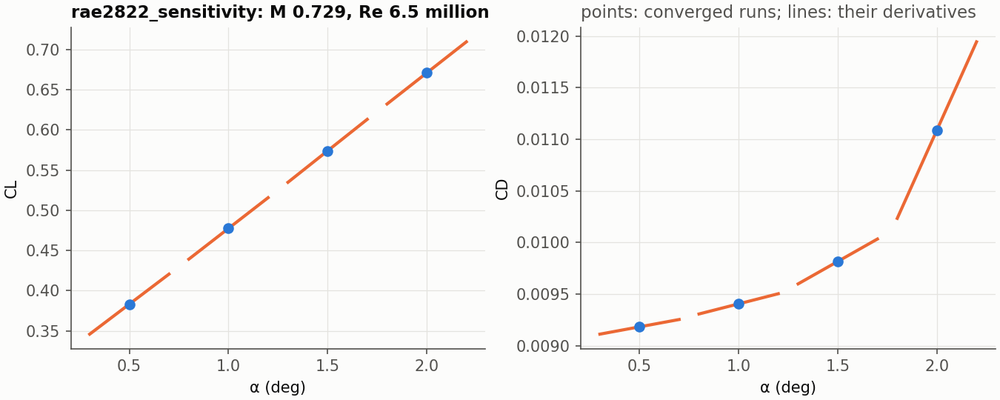

# Derivatives

A converged result gives the derivatives of its force coefficients with
respect to the angle of attack and the Mach number, exact for the discrete
solution, at the cost of one linear solve per parameter:

```python
from jaxrans import load_case, run, sensitivity

result = run(load_case("examples/naca0012_laminar",
                       ("numerical.convergence.forces_tol=null",)))
s = sensitivity(result, outputs=("cl", "cd"), parameters=("alpha", "mach"))
print(s.summary())
s.derivatives["cl"]["alpha"]     # dCL/dalpha, per degree
```

`outputs` are any of `cl`, `cd`, `cm` and `cd_friction`; `parameters` are
`alpha` (in degrees) and `mach` (at a fixed Reynolds number, so the viscosity
`mu_inf = M / Re` changes with it).

## Method

At a converged state the residual vanishes, `R(U*(p), p) = 0`, for every
value of the parameters `p`. Differentiating that identity gives the
derivative of the state, and with it the derivative of any output `J(U, p)`:

```
dR/dU · dU/dp = -∂R/∂p,          dJ/dp = ∂J/∂p + ∂J/∂U · dU/dp
```

One linear solve per parameter gives every output at once (the tangent, or
forward, mode). `dR/dU` is the Jacobian of the residual the run converged,
second order with its limiter, never assembled: its products with a vector
come from `jax.linearize`. `∂R/∂p` and `∂J/∂p` are forward-mode derivatives
with respect to the freestream, which is how the parameters enter.

The linear system is solved by defect correction,

```
x ← x + G (b - A x),         A = dR/dU,   b = -∂R/∂p,
```

where `G` is the linear solve of the implicit solver's own Newton step at the
end of its CFL ramp: GMRES on `V/Δt + dR̃/dU` (`R̃` the first-order
residual), preconditioned by the line solves. The iteration is the implicit
solver linearized at the converged state, so it converges as the solver does,
here about half an order of magnitude every 50 steps. Krylov methods applied
to `A` directly, with the line preconditioner, stall on the exact Jacobian of
the second-order scheme (the design notes give the measurements).

The code is in `solvers/sensitivity.py` (the linear algebra, for any
residual and outputs) and `derivatives.py` (the case's residual, forces and
Newton solve).

## What it needs

- **A converged state.** The formulas hold where `R = 0`; the derivative is
  as good as the convergence. Converge to round-off for derivatives to many
  digits: `convergence.forces_tol` `null`, so the run is not stopped when its
  forces have settled, and `tol` 1e-12 (the default).
- **A differentiable discretization.** `minmod` and `van_albada` cut the
  slope to zero at a local extremum, a kink: the derivative of the discrete
  solution is not defined where a cell sits on it, and near a shock some cell
  always does. On the transonic NACA 0012 of the quickstart notebook (Euler,
  M 0.75, 2 deg) `van_albada` puts the derivative 2e-3 from finite
  differences; `van_albada_smooth`, the limiter's original form without the
  cut, 5e-7 (central differences extrapolated from steps of 0.005 and 0.0025
  deg). Use `van_albada_smooth` with a shock, `none` for smooth flow.

`linear_residuals` reports the relative residual of every solve; it should
be below the requested `tol` (1e-10 by default). The iteration converges as
the implicit solver does, so where the solver stalls, it stalls too: the
RAE 2822 below at 2.5 deg (with `van_albada`), where the run reaches 7.7
orders in 6000 steps, leaves its linear solve at 7e-5. Converge the run
first; raising `maxiter` helps only when the solve is still falling.

## A polar with its derivatives



```bash
python scripts/sensitivity_polar.py examples/rae2822_sensitivity --alpha 0.5 2.0 0.5
```

converges `examples/rae2822_sensitivity` (SA, M 0.729, Re 6.5 million, a
generated 288 x 80 C-grid) at each angle and draws dCL/dalpha and dCD/dalpha
as tangent lines through the points: the drag rise is in the derivatives.

## Verification

`validation/check_sensitivity.py CASE` converges a case, takes its
derivatives and compares them with central finite differences from two more
converged runs (alpha ± 0.01 deg, Mach ± 1e-4):

| case | cells | output | tangent | central FD | difference |
|---|---|---|---|---|---|
| `naca0012_laminar` | 18,432 | dCL/dα | 0.017092675 | 0.017092605 | 4.1e-6 |
| | | dCD/dα | 6.064453e-4 | 6.064337e-4 | 1.9e-5 |
| | | dCM/dα | 8.645651e-3 | 8.645643e-3 | 9.4e-7 |
| `clarky_sa`, 128 x 64 | 12,288 | dCL/dα | 0.10613344 | 0.10613338 | 5.7e-7 |
| | | dCD/dα | 6.591934e-4 | 6.591903e-4 | 4.8e-6 |
| | | dCM/dα | 9.670303e-4 | 9.670407e-4 | 1.1e-5 |
| | | dCL/dM | 0.15275060 | 0.15275068 | 5.6e-7 |
| | | dCD/dM | -6.518500e-4 | -6.518484e-4 | 2.5e-6 |
| | | dCM/dM | -8.877542e-3 | -8.877557e-3 | 1.7e-6 |

The two solves (alpha and Mach) together cost a sixth of one converged
forward run on the laminar case, a quarter on the SA case.

The adjoint mode (one solve per output instead of per parameter, for many
parameters such as a shape) is planned.
