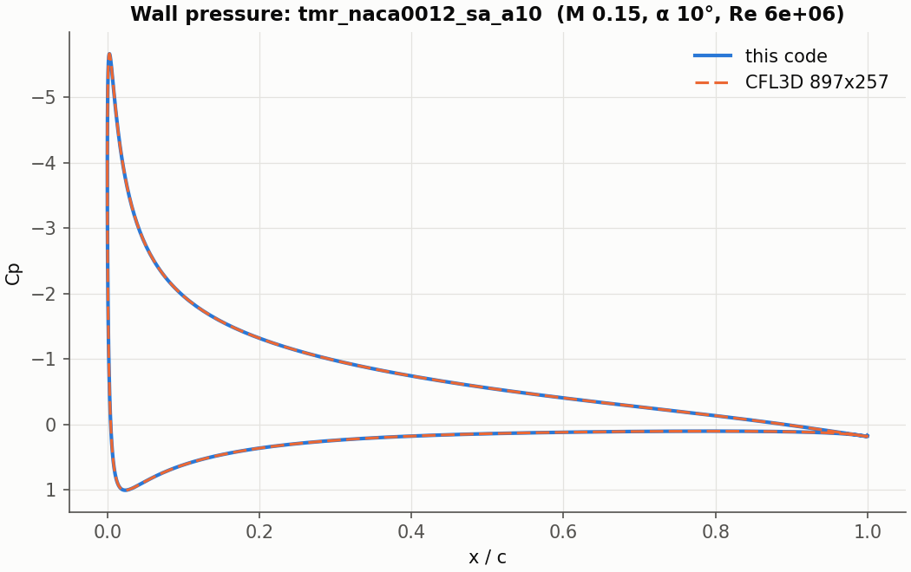
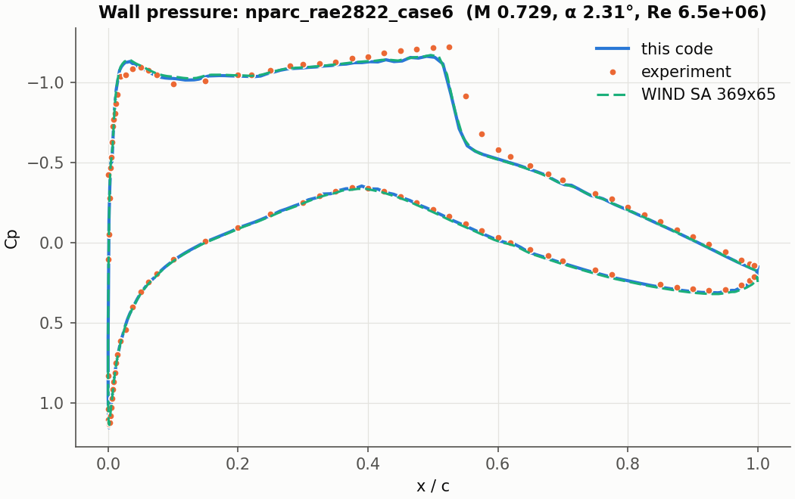

# Validation

Six cases against published data. The solver in `src/jaxrans` knows nothing
about them: each is an ordinary case directory, plus the reference it is judged
against.

| case | reference | this code |
|---|---|---|
| `tmr_flatplate_sa`: flat plate, SA, 137x97 (NASA TMR) | CFL3D, 545x385: Cf(0.97) 2.70562e-3 | 2.70546e-3 |
| `tmr_naca0012_sa_a10`: NACA 0012, SA, 10 deg, 897x257 (NASA TMR) | CFL3D, same grid: CL 1.09112, CD 0.012371 | CL 1.09076, CD 0.012349 |
| `nparc_rae2822_case6`: RAE 2822 case 6, SA, 369x65 (AGARD) | WIND, same grid: CL 0.73096, CD 0.012117, shock 0.5455 c | CL 0.72118, CD 0.012452, shock 0.5455 c |
| `jaxa_30p30n_a5p5`: 30P30N, SA, 5.5 deg, 261k cells (JAXA) | JAXA's RANS: CL 2.877 | CL 2.8756 |
| `gen_30p30n_a5p5`: the same on the generated grid, 165k cells | JAXA's RANS: CL 2.877 | CL 2.846 |
| `tmr_onera_m6_sa_2308`: ONERA M6, SA, 1.08M cells (NASA TMR) | CFL3D, same grid | CL +0.19%, CD -1.74% |

Wall pressure against the references:




## Running them

Most cases read third-party grids: `data/grids/README.md` says where to get each.

```bash
jaxrans validation/cases/nparc_rae2822_case6                 # just the run
python validation/validate.py nparc_rae2822_case6            # the run, judged against its reference
python validation/validate.py --suite rans                   # rans, transonic, high_lift or wing
python validation/validate.py tmr_naca0012_sa_a10 --levels 449-129,897-257   # chosen grid levels
```

Results go to `results/validation/<case>_n<cells around>/`. To compare the wall
distributions:

```bash
python validation/compare_surface.py results/validation/nparc_rae2822_case6_n368 --reference rae2822 --plot cp.png
python validation/compare_sections.py results/validation/tmr_onera_m6_sa_2308_n1081344   # span stations
python validation/compare_30p30n.py RESULT_DIR                                           # per element
```

`check_sensitivity.py` checks the derivatives of a case against finite
differences. `highlift_envelope.py` builds the multi-element grid over a range
of settings.

## What is in a case

`cases/<name>/` holds `case.json` and `numerical.json`, as any case, and
`reference.json`, which only `validate.py` reads:

| key | meaning |
|---|---|
| `suite`, `order` | the suite, and the case's place in it |
| `levels` | grid levels, coarsest first: each a set of `domain` keys merged into `case.json` |
| `reference` | sourced CL / CD, optional Cf at one station, spread between sources, tolerances, `isolates`, `sources`, `notes` |
| `settled_cl_spread` | largest CL range over the last quarter of blocks that counts as settled |

`references/<source>/` holds the published data, each with a README naming its
source.
